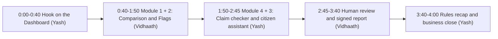

# PollToll — Judge Pitch, Live Demo Script & 60s Reel Playbook

> [!IMPORTANT]
> **Say this in the first 20 seconds:**
> *"Electoral rolls change by lakhs of names every revision, and rumours spread faster than anyone can check them. PollToll lines up two versions of a roll entry by entry, tells apart people who **moved booths** from people who were **removed**, flags only what is statistically unusual, and signs every audit so anyone can verify it. It never declares fraud. A flag means a person should look closer."*

All numbers below are the live values for **2025 Final Roll → 2026 Draft Roll** (`v2025_final → v2026_draft`). If you change the comparison or the data, re-read them off the screen.

| Fact | Value |
| :--- | :--- |
| Electors | 7,809 → 7,804 |
| Removed / added | −241 / +236 |
| Moved to another booth (not removed) | 338 |
| Entries corrected | 90 |
| Flags raised | 6 (2 need a closer look) |
| PS-109 | 352 names left (raw drop 37.0%): 338 moved intact to PS-110, only 14 removed. Net removal 1.47% vs 1.81% history |
| PS-302 | 9.8% removed (71 of 723), 95% CI [7.9%, 12.2%], history 1.47%, **+18.5σ**, 0 transfers |
| PS-104 | 11.5% removed (73 of 637), **+23.1σ**. Innocent explanation on the card: hostel batch graduating |

---

## 1. Stage Flow (4 minutes), mapped to the brief

Name the module out loud each time you show it ("This is module 1, anomaly detection…"). Judges are scoring against the brief's list.

---

## 2. Pre-Stage Checklist (5 minutes before)

1. **Start the app:** double-click **Start PollToll** in the `KRMWin` folder. Wait for `http://localhost:3000` to load. Start it once while online so the fonts are cached.
2. **Pre-warm the AI cache** so Hindi and Gujarati answers return instantly even if Wi-Fi drops: `python3 scripts/prewarm_demo_cache.py`.
3. **Browser:** full screen on `http://localhost:3000`, Dashboard open, language **EN**, zoom 110% for the projector.
4. **Review step:** PS-302 already has a reviewer note (CORR-0006) in the demo data. For the live review, use the **PS-203** (crowded address) flag so judges see the open-flag count drop.
5. *(Optional)* Let judges try it on their phones: `cloudflared tunnel --url http://localhost:3000` and show the QR code.

---

## 3. Minute-by-Minute Script

### Act I — Hook on the Dashboard (`0:00 – 0:40`, Yash)
- **Screen:** Dashboard. The roll arithmetic is the first thing on screen.
- *"A viral message says 340 voters vanished from Booth 109 overnight. Citizens panic, and nobody can audit thousands of roll PDFs by hand."*
- Point at the big line: **7,809 − 241 + 236 = 7,804**. *"This is the whole revision in one line. And underneath: 338 people moved to another booth and 90 entries were corrected. A naive script would have counted all of them as deleted."*
- *"We checked what the Election Commission's own ERONET already does and we don't rebuild it. PollToll audits what gets published, from the outside."*

### Act II — Module 1 (anomaly detection) and Module 2 (plain-language explanations) (`0:40 – 1:50`, Vidhaath)
1. **Sidebar → Comparison.** It opens on PS-109 with the old roll on the left and the new roll on the right.
   - *"Each row is one voter. Left is where they were, right is where they are now. Teal means moved. These people weren't removed; they're in PS-110 with new serial numbers. 352 names left PS-109; 338 of them are right here. Only 14 were actually removed. That's 1.47%, which is normal for this booth."*
   - Click the **PS-104** booth button: struck-through red names against empty "removed" slots. *"Here the removals are real."*
2. **Sidebar → Flags.** Click the **PS-302** flag.
   - *"PS-302 lost 9.8% of its voters, against a history of about 1.5%. That's 18.5 standard deviations, with zero transfers to explain it."*
   - Walk the 5-part card quickly: what changed, the exact rule (`RULE_HIST_DEL_SPIKE@1.0.0`), **innocent explanations** (redevelopment, backlog clearance), **what public data can't prove** (Rule 21-A notices, BLO checklists) and the next step. *"94% confidence, and it tells you why. We never say fraud. We say: here's what a person should check next."*

### Act III — Module 4 (claim checker) and Module 3 (citizen assistant) (`1:50 – 2:45`, Yash)
- **Sidebar → Citizen check.**
1. **Claim checker:** pick the preset **"Booth 109 '340 Vanished Voters' Rumor"** → Check Claim.
   - *"Three columns: what the roll math verifies (352 names left PS-109), what is disputed (338 of them moved intact), and what public data can't prove (whether every household got a slip about the room change). Claims from every side get the same treatment."*
2. **Citizen assistant:** switch the language to **ગુ** or **हि**, click the **Booth Split (PS-109 → PS-110)** chip (`SYN-GJ-109-0042`), ask, then press **Listen Aloud**.
   - *"A voter in Booth 109 sees her name is safe: active, moved to PS-110, with her new serial number, in her own language, by voice. It also tells her which official form to use if something's wrong."*

### Act IV — Human review and the signed report (`2:45 – 3:40`, Vidhaath)
1. **Sidebar → Review.** Select the **PS-203** flag, choose "Request Authorized BLO/ERO Check", type a short neutral note, and click **Append to Ledger**.
   - *"A person decides, not the software. The note is appended to a hash-chained log, so the original flag is never overwritten. Watch the open-review count drop."*
2. **Sidebar → Report.** Click **Re-Issue Signed Receipt**: green, 4 of 4 checks pass, and your new note is in the chain.
3. **The wow moment:** click **Simulate 1-Byte Tamper Attack**. It turns red: SHA-256 mismatch and the Ed25519 signature is rejected. Click **Restore Authentic Receipt** to turn it green again.
   - *"Any newsroom or court can verify this in their own browser, without trusting us."*

### Act V — Rules recap and close (`3:40 – 4:00`, Yash)
- *"Every rule in the brief is built into the product: synthetic data only, so uploads without SYN- IDs are rejected. Flags are for human review, never accusations. Every output shows its reasoning and confidence, including the citizen lookup. And claims from every side go through the same checker."*
- **Closing line:** *"Citizens check their names for free. Observers, universities and newsrooms license the audit and the signed reports. We sell evidence, not accusations."*

---

## 4. Tough Judge Q&A

| Likely question | Answer |
| :--- | :--- |
| **"Doesn't ECI's ERONET already do this?"** | *"ERONET is the Election Commission's internal registration system, and it already does duplicate photo and demographic matching. We don't rebuild that. PollToll is independent and works after publication: it compares published versions, reconciles booth splits, tests changes against history with confidence intervals, and signs receipts anyone can verify. Public documents can't tell us what ERONET runs internally, and we say so."* See [ERONET_GAP_ANALYSIS.md](./ERONET_GAP_ANALYSIS.md). |
| **"How do you stop the AI hallucinating or being used as a political weapon?"** | *"The audit maths uses no AI: diffs, z-scores and Wilson intervals are plain code with a versioned rule pack (`polltoll-rules@1.0.0`). AI only writes the plain-language explanations, and every one is forced into the 5-part and 3-column formats, which always include innocent explanations and what can't be proven. A neutrality filter (`sanitize_neutral_text` in `backend/app/services/ai_explainer.py`) blocks accusatory wording."* |
| **"Did you use real voter data?"** | *"None. Every record is synthetic (`SYN-GJ-*`), and the upload endpoint (`backend/app/engine/ingest.py`) rejects any file whose IDs don't start with SYN-. You can see it reject one on the Dashboard."* |
| **"What if the AI API goes down on election day?"** | *"Core auditing uses no AI at all. Repeat questions come from a local cache, live calls fail over between Gemini and Groq, and if everything is offline, the citizen assistant and claim checker fall back to built-in EN/HI/GU answers. The CLI (`backend/polltoll_cli.py`) runs and verifies audits fully offline."* |
| **"Your PS-109 numbers: is it 340 or 352?"** | *"340 is what the rumour claims. The roll shows 352 names left PS-109: 338 moved to PS-110 and 14 were removed. The checker verifies the real count instead of repeating the rumour's number."* |

---

## 5. Storyboard for the 45–90 Second Video (Deliverable B)

> [!TIP]
> The brief requires: **(1)** a hook in the first 5 seconds, **(2)** behind-the-scenes of the team building, **(3)** a short product demo, and **(4)** AI used in making the video (AI voiceover, auto-captions, AI visuals or AI editing). Put an on-screen credit for the AI tools you used.

| Timestamp | Visual | Voiceover / captions |
| :--- | :--- | :--- |
| **`0:00 – 0:05` Hook** | Fast zoom on a mock WhatsApp forward: *"340 VOTERS VANISHED IN BOOTH 109?!"*, then smash-cut to Vidhaath and Yash. | *"When voter lists change by lakhs of names, rumours travel faster than facts."* |
| **`0:05 – 0:20` Behind the scenes** | Coding side by side, the whiteboard, and the two AI coding agents messaging each other on GitHub Issue #1. | *"In 24 hours we built PollToll, an independent audit for electoral rolls."* |
| **`0:20 – 0:45` Demo, 3 shots** | **1:** Comparison page, PS-109 rows in teal: moved, not removed. **2:** PS-302 flag card with +18.5σ, then the Gujarati citizen answer read aloud. **3:** Report → Simulate Tamper turns red. | *"PollToll separates booth moves from real removals, flags only true outliers with confidence levels, answers citizens by voice in English, Hindi and Gujarati, and signs every audit so anyone can check it."* |
| **`0:45 – 0:58` Close** | Dashboard roll arithmetic, then the title card **PollToll — Evidence, not accusations**, with a footer credit: *"Voiceover and captions made with AI"*. | *"Free checks for every citizen. Signed evidence for every observer. PollToll."* |
