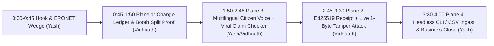

# PollToll — Judge Pitch, Live Demo Choreography & 60s Reel Playbook

> [!IMPORTANT]
> **Your Core Winning Thesis (Say This in the First 20 Seconds):**
> *"We are NOT rebuilding ECI's internal ERONET voter-registration or duplicate-photo tool. PollToll is **independent electoral change-audit infrastructure**—like `git diff` + statistical confidence intervals + `Ed25519` cryptographic receipts over **published** electoral-roll snapshots—so observers, journalists, and citizens can separate innocent booth splits from true statistical outliers without ever declaring fraud."*

---

## 1. Stage Flow Overview (4 Minutes Total)



---

## 2. Pre-Stage Checklist (5 Minutes Before Judging)

1. **Ensure both servers are live** (`http://localhost:3000` and `http://127.0.0.1:8000`).
2. **Pre-warm DuckDB AI Cache** so preset claims in English, Hindi, and Gujarati return in `<2 ms` even if venue Wi-Fi drops:
   ```zsh
   python3 /Users/root1/KRMWin/scripts/prewarm_demo_cache.py
   ```
3. **Browser Window Setup** (`Cmd` + `+` once to `110%` zoom for projector readability):
   - **Tab 1**: `http://localhost:3000` opened on **PollToll Audit** (`v2025_final` → `v2026_draft`)
   - **Tab 2**: [polltoll_infrastructure_wireframe.html](file:///Users/root1/.gemini/antigravity/brain/545e6cb4-5406-4bc1-9858-1ab1245bd504/polltoll_infrastructure_wireframe.html) (optional 10-second architecture flash)
   - **Terminal Split**: Ready in `/Users/root1/KRMWin/backend` to flash offline CLI verification (`uv run python polltoll_cli.py gap-matrix`)
4. *(Optional Bonus)* **Let Judges Try PollToll Verify on Their Own Phones via Cloudflare Quick Tunnel**:
   - If you want judges to scan a QR code and test Hindi/Gujarati claims live on their phones, run `brew install cloudflared && cloudflared tunnel --url http://localhost:3000` (note: since `frontend` calls `127.0.0.1:8000` by default, keep stage laptop HDMI as your primary demo screen).

---

## 3. Minute-by-Minute Click & Speaking Script (`Vidhaath + Yash`)

### Act I — The Hook & Serious ERONET Differentiation (`0:00 – 0:45`)
- **Speaker (Yash)**:
  - *"Every election season, roll revisions add or delete millions of names. Viral screenshots claim '340 voters vanished from Booth 109 overnight!' Citizens panic, observers can't audit PDFs at scale, and trust erodes regardless of the truth."*
  - *"Most hackathon projects say 'we detect duplicate voters with AI.' We checked the Election Commission's own documentation first: **ERONET** already runs a Unified National Photo Electoral Roll with Demographic and Photo Similar Entries workflows. Competing by rebuilding ERONET is a losing strategy."*
  - *"Instead, **PollToll** builds what ERONET isn't designed to be: an **independent external change-audit protocol** over published roll snapshots. We sell verifiable evidence and uncertainty math—never accusations."*

---

### Act II — Plane 1: Electoral Change Ledger & Statistical Anomaly Engine (`0:45 – 1:50`)
- **Screen**: [AuditWorkspace.tsx](file:///Users/root1/KRMWin/frontend/src/components/AuditWorkspace.tsx) (`PollToll Audit` tab, `2025 Final Roll` → `2026 Draft Roll` over 100% synthetic `SYN-GJ-*` data).
- **Clicks & Narration (Vidhaath)**:
  1. **Point to the top KPI strip & Recharts Bar Chart**:
     - *"Look at Booth `PS-109` vs `PS-302` on our chart. A naive diff script sees `PS-109` drop by 340 voters—a massive **35.8% raw drop**—and screams 'mass deletion!'"*
  2. **Click the `PS-109` Reconciliation Flag (`RULE_BOOTH_SPLIT_RECONCILE@1.0.0`)**:
     - *"PollToll's DuckDB Change Ledger tracks EPIC lineage across the entire constituency before running anomaly math. It proves **338 of those 340 voters were NOT deleted**—their EPIC IDs moved intact to newly created Wing-B (`PS-110`). True net deletion is **1.47%**, right inside the historical baseline!"*
  3. **Click the `PS-302` Outlier Flag (`RULE_HIST_DEL_SPIKE@1.0.0`)**:
     - *"Now contrast `PS-302`: **9.8% net deletions** (`95% Wilson CI [8.0%, 11.9%]`), `+8.4σ` above its multi-cycle baseline with **zero** cross-booth transfers."*
     - **Point to the 5-Part Evidence Card**: *"Notice our strict neutrality guardrail: PollToll shows (1) exact change math, (2) versioned rule `polltoll-rules@1.0.0`, (3) **innocent administrative explanations** like municipal redevelopment, (4) **missing non-public evidence**—such as BLO house-to-house checklists and Rule 21-A notices that public PDFs cannot prove—and (5) the authorized human review step."*
  4. **Click Ledger Filter pill `BOOTH_TRANSFERRED`, then click `Inspect EPIC` on `SYN-GJ-109-0042`** (jumps smoothly into **PollToll Verify**!).

---

### Act III — Plane 3: Multilingual Citizen Assistant & Viral Claim Checker (`1:50 – 2:45`)
- **Screen**: [VerifyPortal.tsx](file:///Users/root1/KRMWin/frontend/src/components/VerifyPortal.tsx) (`PollToll Verify` tab).
- **Clicks & Narration (Yash / Vidhaath)**:
  1. **Citizen Lookup + Gujarati / Hindi Switch**:
     - *"For ordinary citizens, PollToll Verify is free in **English**, **Hindi (हिन्दी)**, and **Gujarati (ગુજરાતી)**."*
     - Toggle the top language pill `English` → `ગુજરાતી` (or `हिन्दी`). Show `SYN-GJ-109-0042`'s 4-cycle timeline (`2024 Final` → `2026 Draft`) proving their registration is **Active & Transferred to `PS-110`**, plus click **Listen / जवाब सुनें / જવાબ સાંભળો** (or Mic) for voice accessibility and official ECI **Form 6 / Form 7 / Form 8** guidance.
  2. **3-Bucket Viral Claim Checker**:
     - Click preset **"Booth 109 '340 Vanished Voters' Rumor"** → click **Check Claim**.
     - *"Instead of a black-box 'True/False' label, PollToll decomposes any viral claim from any political side into three auditable columns: **Verified from Published Roll** (340 booth outflow), **Disputed Interpretation** (338 moved intact to `PS-110`), and **Cannot Be Proven from Public Data** (whether physical voter slips reached every household), complete with confidence score and reasoning steps."*

---

### Act IV — Plane 2 & 4: `Ed25519` Tamper Simulator & Infrastructure Close (`2:45 – 4:00`)
- **Screen**: Switch to `PollToll Assurance` ([AssuranceCenter.tsx](file:///Users/root1/KRMWin/frontend/src/components/AssuranceCenter.tsx)), then `Infra / API & CLI` ([InfraConsole.tsx](file:///Users/root1/KRMWin/frontend/src/components/InfraConsole.tsx)).
- **Clicks & Narration**:
  1. **Show Green `VERIFIED` WebCrypto Badge (`PollToll Assurance`)**:
     - *"Why should a court, newsroom, or university trust our software? Every PollToll run emits an **Independent Audit Receipt** containing canonical `SHA-256` snapshot hashes, rule version, and append-only correction history, signed with **`Ed25519`** and verified right inside the browser's WebCrypto engine."*
  2. **THE WOW MOMENT — Click the Red `Simulate 1-Byte Tamper Attack` Button**:
     - Watch the badge flip instantly to **RED `SIGNATURE INVALID — PAYLOAD TAMPERED`** when `deleted` is forged without the private key! Click **Restore Authentic Receipt** to flip back to green.
     - Scroll down 2 seconds to flash the **Cited ERONET Feature-by-Feature Gap Matrix** embedded directly in the console.
  3. **Close on `Infra / API & CLI` (`3:35 – 4:00`)**:
     - Click `Infra / API & CLI` → point to **Live CSV Snapshot Ingestion** (`SHA-256` content-addressed), **Headless Auditor CLI** ([polltoll_cli.py](file:///Users/root1/KRMWin/backend/polltoll_cli.py)), and our **Multi-Cloud Quota Shield** (`Gemini + Groq LPU + DuckDB Cache`).
     - **Closing Line**: *"Citizens get PollToll Verify free; election-observation groups, universities, and civic foundations license PollToll Audit & Assurance infrastructure. We sell evidence and accountability—not accusations."*

---

## 4. Tough Judge Q&A Cheat Sheet

| Likely Judge Question | Crisp Winning Answer |
| :--- | :--- |
| **"Doesn't ECI's ERONET already detect duplicates and manage rolls?"** | *"Yes—and we explicitly cite ERONET's UNPER and DSE/PSE capabilities in [ERONET_GAP_ANALYSIS.md](file:///Users/root1/KRMWin/docs/ERONET_GAP_ANALYSIS.md). ERONET is an internal operational workflow for EROs. PollToll is **external, independent post-publication change-audit infrastructure** with cross-booth split reconciliation, 95% confidence intervals, explicit missing-evidence disclosure, and client-verifiable `Ed25519` audit receipts. Note we also state clearly that public docs alone cannot prove what internal scripts ECI runs privately."* |
| **"How do you prevent your AI from hallucinating or being used as a political weapon?"** | *"Three hard architectural controls: (1) **Zero-LLM audit math**—all diffs, Z-scores, and Wilson CIs are computed deterministically in DuckDB (`polltoll-rules@1.0.0`); (2) **Mandatory 3-bucket & 5-part schemas** forcing innocent explanations and 'Cannot Be Proven from Public Data' on every flag; (3) **Regex & schema neutrality sanitizers** ([`sanitize_neutral_text`](file:///Users/root1/KRMWin/backend/app/services/ai_explainer.py#L472-L476)) blocking accusatory verdicts."* |
| **"Did you use any real voter data or scrape ECI PDFs?"** | *"Zero real voter PII. Every record is 100% deterministic synthetic data (`SYN-GJ-*`), and our ingestion endpoint ([ingest.py](file:///Users/root1/KRMWin/backend/app/engine/ingest.py)) enforces a hard guardrail rejecting any upload whose IDs lack the `SYN-` prefix."* |
| **"What happens if an LLM API goes down or hits rate limits during an election?"** | *"Show the `Infra / API & CLI` tab: core auditing uses 0 LLM tokens, repeat queries hit our persistent `SHA-256` DuckDB cache in `<2 ms`, live calls fail over across Gemini + Groq LPU pools, and even total cloud blackout falls back seamlessly to localized EN/HI/GU deterministic responses."* |

---

## 5. Storyboard for Your 45–90 Second Content Video (Deliverable B)

> [!TIP]
> The prompt requires: **(1) Hook in first 5s**, **(2) Behind-the-scenes of Vidhaath & Yash building**, **(3) Short product demo**, and **(4) Explicit AI used in making the video** (e.g., AI voiceover, AI auto-captions, or AI B-roll/animation).

| Timestamp | Visual Shot | Voiceover / On-Screen Auto-Caption |
| :--- | :--- | :--- |
| **`0:00 – 0:05` (The 5s Hook)** | Fast zoom on a dramatic mock WhatsApp message: *"340 VOTERS VANISHED IN BOOTH 109?!"* → Smash-cut to Vidhaath/Yash looking at camera. | *"When electoral rolls change by millions of names, rumours travel faster than facts—and nobody can audit the math."* |
| **`0:05 – 0:20` (Behind the Scenes + A2A Twist)** | Over-the-shoulder clip of Vidhaath & Yash coding side-by-side, whiteboard/wireframe ([polltoll_infrastructure_wireframe.html](file:///Users/root1/.gemini/antigravity/brain/545e6cb4-5406-4bc1-9858-1ab1245bd504/polltoll_infrastructure_wireframe.html)), and a quick shot of your two Antigravity agents messaging each other on GitHub Issue `#1`! | *"During this hackathon, we—and our two synced AI coding agents—checked ECI's ERONET docs first, and built what ERONET isn't: **PollToll**, independent electoral change-audit infrastructure."* |
| **`0:20 – 0:45` ( Crisp 3-Shot Product Demo)** | **Shot 1**: `PS-109` vs `PS-302` chart + 5-part explanation card.<br>**Shot 2**: Toggle `English → ગુજરાતી / हिन्दी` on **PollToll Verify** + 3-bucket Claim Checker.<br>**Shot 3**: Click **Simulate 1-Byte Tamper Attack** → flashes RED `SIGNATURE INVALID`! | *"PollToll reconciles innocent booth splits, flags real statistical outliers with 95% confidence intervals, answers citizens by voice in English, Hindi, and Gujarati, and signs every audit with client-verifiable Ed25519 cryptography."* |
| **`0:45 – 0:58` (Close + AI Credit Tag)** | Split screen of CLI terminal + Control Console + closing title card: **PollToll — Evidence & Accountability, Not Accusations** *(Small footer badge: "Edited with AI voiceover & AI auto-captions")*. | *"Free verification for every citizen. Cryptographic assurance for every observer. PollToll."* |
