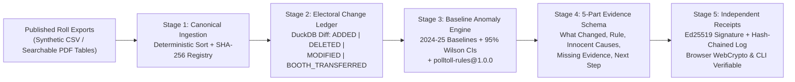

# PollToll — Infrastructure Topology & UI Control-Plane Wireframe

> **Design Principle:** PollToll is **trusted electoral change-audit infrastructure** (comparable to Certificate Transparency / Sigstore / Stripe Workbench), **not** a brochure website or accusation dashboard. Every capability is exposed simultaneously via **deterministic DuckDB pipelines**, **REST/OpenAPI contracts (`shared/openapi.json`)**, **a headless auditor CLI (`backend/polltoll_cli.py`)**, and **a 4-plane web Control Console**.

---

## 1. Five-Stage Infrastructure Dataflow



---

## 2. Control-Plane Wireframe Layout (4 Planes)

> **Note (UI v2):** the console now uses a left sidebar with Dashboard, Comparison, Flags, Review, Report and Citizen check. The planes below map onto it: Audit → Dashboard + Comparison + Flags, the reviewer form → Review, Assurance → Report, Verify → Citizen check, and CSV ingestion moved onto the Dashboard. Numbers below are the live values for `v2025_final → v2026_draft`.

### Global Protocol Top Bar (Persistent Across All Planes)
```text
+---------------------------------------------------------------------------------------------------+
| [POLLTOLL // AUDIT PROTOCOL v0.1]  RulePack: polltoll-rules@1.0.0  Signer: Ed25519   [EN|हिन्दी|ગુજ] |
| GUARDRAIL TELEMETRY: 100% Synthetic Data • Neutrality Enforced • Flags != Proof of Wrongdoing     |
+---------------------------------------------------------------------------------------------------+
| [1. Audit Ledger Plane]  [2. Assurance & Receipts]  [3. Public Verify Edge]  [4. Infra / API CLI] |
+---------------------------------------------------------------------------------------------------+
```

### Plane 1: `PollToll Audit` (Institutional Change-Audit Workspace)
```text
+---------------------------------------------------------------------------------------------------+
| SNAPSHOT DIFF BAR:  [From: v2025_final (SHA256: ...)]  <-->  [To: v2026_draft (SHA256: ...)]      |
+----------------+---------------+----------------+-------------------+--------------+--------------+
| Electors       | Additions (+) | Net Deletions  | Reconciled Splits | Modified (Δ) | Rule Flags   |
| 7,809 -> 7,804 | +236          | -241           | 338 (PS109->PS110)| 90           | 6 Triggered  |
+----------------+---------------+----------------+-------------------+--------------+--------------+
| [Chart A: Raw Drop % vs Reconciled Net Deletion %] | [Chart B: Stacked Booth Change Composition]  |
|   Shows PS-109 37% raw drop -> 1.47% net deletion  |   Added / Transferred / Modified / Deleted   |
+----------------------------------------------------+----------------------------------------------+
| LEFT RAIL: VERSIONED RULE QUEUE (5/12 Cols)        | RIGHT PANE: 5-PART EVIDENCE BRIEF (7/12)     |
| - [HIGH] PS-302 RULE_HIST_DEL_SPIKE@1.0.0 (+18.5σ) | - Uncertainty Box: Point, 95% CI, Baseline, n|
| - [HIGH] PS-104 RULE_HIST_DEL_SPIKE@1.0.0 (+23.1σ) | - 1. What Changed (+ Clickable Sample EPICs) |
| - [MOD]  PS-203 RULE_HOUSEHOLD_DENSITY@1.0.0       | - 2. Exact Rule & Mathematical Formula       |
| - [MOD]  PS-207 RULE_AGE_COHORT_IMPLAUSIBLE@1.0.0  | - 3. Innocent Administrative Explanations    |
| - [MOD]  PS-305 RULE_LEXICAL_DUP_CLUSTER@1.0.0     | - 4. Missing Non-Public Evidence             |
| - [INFO] PS-109 RULE_BOOTH_SPLIT_RECONCILE@1.0.0   | - 5. Next Step + Append Hash-Chain Note Form |
+----------------------------------------------------+----------------------------------------------+
| SOURCE-LINKED CHANGE LEDGER TABLE: Filter [ALL | BOOTH_TRANSFERRED | DELETED | MODIFIED | ADDED]  |
+---------------------------------------------------------------------------------------------------+
```

### Plane 2: `PollToll Assurance` (Zero-Trust `Ed25519` Receipts & ERONET Gap Matrix)
```text
+---------------------------------------------------------------------------------------------------+
| [Issue Signed Ed25519 Receipt]  [Verify in Browser (WebCrypto)]  [Simulate 1-Byte Tamper] [Export]|
+------------------------------------------------------------+--------------------------------------+
| CRYPTOGRAPHIC RECEIPT MANIFEST & 4-CHECK VERIFIER          | APPEND-ONLY CORRECTION LOG CHAIN     |
| - [✓] Payload == Canonical Signed JSON                     | CORR-0001 prev:0000.. -> hash:a91c.. |
| - [✓] Browser SHA-256 == Receipt Digest                    | CORR-0002 prev:a91c.. -> hash:7f02.. |
| - [✓] SubtleCrypto Ed25519 Signature Valid                 | CORR-0003 Reviewer Evidence Attached |
| - [✓] Correction Log Hash Chain Matches Signed Head        |                                      |
+------------------------------------------------------------+--------------------------------------+
| CITED ERONET vs. POLLTOLL FEATURE-BY-FEATURE GAP MATRIX (7 Capabilities + Epistemic Limits)       |
+---------------------------------------------------------------------------------------------------+
```

### Plane 3: `PollToll Verify` (Free Public Multilingual Edge — EN / हिन्दी / ગુજરાતી)
```text
+---------------------------------------------------------------------------------------------------+
| CITIZEN ROLL-CHANGE ASSISTANT (Text + Push-to-Talk Voice + Audio Readout)                         |
| Quick Chips: [SYN-GJ-109-0042 Split] [SYN-GJ-104-0019 Deleted] [SYN-GJ-207-0011 Age Typo]         |
| [EPIC Input] [Natural Language Question in EN/HI/GU]  [Check & Explain] [Voice Query] [Listen]    |
| -> 4-Snapshot Longitudinal Timeline (v2024_final -> v2025_draft -> v2025_final -> v2026_draft)    |
| -> Official ECI Next Steps (Form 6 / Form 7 / Form 8) + Transparent Reasoning Trace               |
+---------------------------------------------------------------------------------------------------+
| LEDGER-GROUNDED VIRAL CLAIM CHECKER                                                               |
| +-------------------------------+-------------------------------+-------------------------------+ |
| | 1. Verified by Roll Math      | 2. Disputed Framing           | 3. Unprovable from Public PDF | |
| +-------------------------------+-------------------------------+-------------------------------+ |
+---------------------------------------------------------------------------------------------------+
```

### Plane 4: `PollToll Infra / API & CLI` (Developer & Institutional Ingestion Plane)
```text
+---------------------------------------------------------------------------------------------------+
| LIVE SNAPSHOT INGESTION PIPELINE (`POST /api/v1/ingest/snapshot`)                                 |
| [Snapshot ID] [Label] [CSV Roll Rows] -> Canonical SHA-256 Hashing -> DuckDB Registration         |
+----------------------------------------------------+----------------------------------------------+
| HEADLESS AUDITOR CLI (`polltoll_cli.py`)           | OPENAPI v3.1 & SDK INTEGRATION               |
| - Reproducible CI/air-gapped diff & receipt verify | - Live curl / Python / TypeScript snippets   |
+----------------------------------------------------+----------------------------------------------+
```
